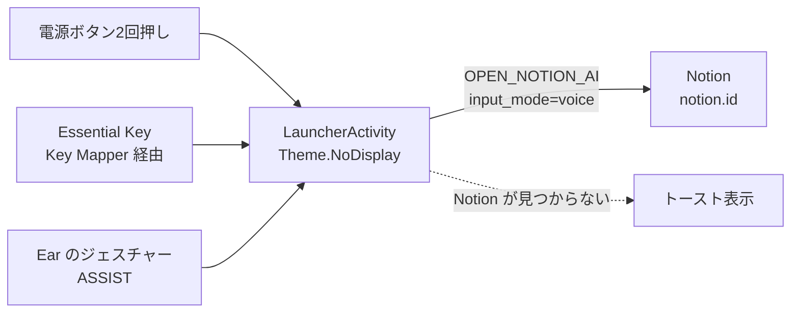
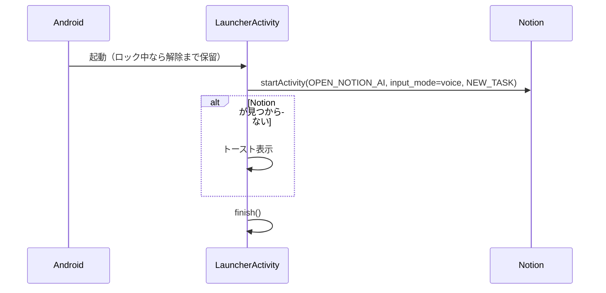

# 設計

## 全体構成

中継アプリを挟む理由は [ADR 0002](adr/0002-relay-app-for-intent-extra.md)。

## ディレクトリ構成と各モジュールの責務

| パス | 責務 |
|---|---|
| `src/dev/local/notionvoice/LauncherActivity.java` | インテントを組み立てて送り、終了する（唯一のソース） |
| `AndroidManifest.xml` | アクティビティ、インテントフィルター（`LAUNCHER`、`ASSIST`）、`<queries>` の宣言。バージョンと SDK レベルは持たない |
| `res/values/strings.xml` | 表示名と、エラーメッセージ |
| `res/values/colors.xml` | アダプティブアイコンの背景色 |
| `res/mipmap-*` | アイコン（`make-icon.ps1` が生成した画像） |
| `build.ps1` | APK のビルド一式。バージョンと SDK レベルの唯一の出典 |
| `make-icon.ps1` | マイク形状のアイコンを描画して、`res/` 配下の画像と確認用プレビューを出力する |

## データの流れ

### 起動時

アクティビティは `Theme.NoDisplay` で、`onCreate` の中で必ず `finish()` する。`noHistory`、`excludeFromRecents`、`taskAffinity=""` により、履歴やタスクに残らない。

### ビルド時（`build.ps1`）

1. ツールチェーンを探索する（[ADR 0006](adr/0006-auto-detect-toolchain.md)）。アイコンが未生成なら `make-icon.ps1` を実行する。
2. `aapt2 compile` でリソースをコンパイルする。
3. `aapt2 link` でリソースをリンクし、`R.java` を生成する。バージョンと SDK レベルはここで注入する（[ADR 0004](adr/0004-version-source-in-build-script.md)）。
4. `javac`（`-source 8 -target 8`）でコンパイルする。
5. `d8` で dex に変換し、APK に格納して `zipalign` する。
6. `apksigner` で、ローカルの `debug.keystore` を使って署名する（なければ `keytool` で生成する）。

Gradle を使わない理由は [ADR 0003](adr/0003-build-without-gradle.md)。

## 外部依存

| 依存 | 用途 |
|---|---|
| Notion アプリ（`notion.id`） | 起動先。アクションと extra は非公開仕様 |
| Android SDK（build-tools、platform） | `aapt2`、`d8`、`zipalign`、`apksigner`、`android.jar` |
| JDK | `javac`、`keytool` |
| .NET（`System.Drawing`、`System.IO.Compression`） | アイコンの描画（`make-icon.ps1`）、APK への dex の格納（`build.ps1`） |

外部ライブラリは使っていない。
